<div align="center">



<a href="https://git.io/typing-svg">
  
</a>

<br><br>

[](mailto:YOUR_EMAIL@example.com)
[](https://www.linkedin.com/in/YOUR_USERNAME/)
[](https://github.com/YOUR_USERNAME)

</div>

---

## 👋 Hello, World

```python
class JothiVishnuvardhan:
    role      = "Software Engineer (aspiring)"
    education = "B.Tech, Electronics & Communication Engineering (2026)"
    languages = ["Python", "SQL", "JavaScript"]
    focus     = ["AI/ML", "RAG chatbots", "Database-driven apps"]
    mindset   = "Analytical, curious, always shipping something"

    def currently(self):
        return "Looking for a role where I can build real-world solutions"
```

I'm a recent graduate with a strong base in **Python, SQL, DBMS and AI/ML**. I like building things end to end, from the database schema to the chat interface, and I'm looking for a Software Engineer role where I can keep growing while contributing to real products.

---

## 🧰 Tech Stack

<div align="center">


</div>

| Area | What I work with |
|:--|:--|
| 🐍 **Programming** | Python |
| 🗄️ **Databases** | SQL, DBMS, MySQL |
| 🌐 **Web** | HTML, CSS, JavaScript |
| 🤖 **AI / ML** | Supervised & Unsupervised Learning, Classification, Regression, Algorithms |
| 🛠️ **Tools** | Git, GitHub, VS Code |

---

## 🚀 Featured Projects

<table>
<tr>
<td width="50%" valign="top">

### 🎓 GenAI Academic Helpdesk
`Python` `Flask` `LangChain` `Hugging Face` `ChromaDB`

An AI chatbot that answers student questions from uploaded academic PDFs.

- Retrieval-Augmented Generation with LangChain, ChromaDB, Hugging Face embeddings and FLAN-T5
- Interactive HTML/CSS/JS chat interface
- Shows the source PDF and page for each answer

</td>
<td width="50%" valign="top">

### 📦 Inventory Management System
`Python` `MySQL`

A database-driven app to manage products, customers, suppliers, sales and purchases.

- Full CRUD operations via `mysql-connector-python`
- Relational schema with primary and foreign keys
- Menu-driven workflows for every module

</td>
</tr>
</table>

---

## 🔄 How I Build

<div align="center">

`Understand the problem` ➜ `Design the data` ➜ `Code in Python` ➜ `Test & debug` ➜ `Iterate`

</div>

---

## 🎓 Education

| Level | Institution | Result | Year |
|:--|:--|:--|:--:|
| **B.Tech, ECE** | Madanapalle Institute of Technology and Science | CGPA 8.80 / 10 | 2026 |
| **Class XII** | Bellary Independent P.U. College | 97% | 2022 |
| **SSC** | AP Model School | 94% | 2020 |

## 📜 Certification

- 🐍 **Joy of Computing using Python**, NPTEL

---

## 📊 GitHub Stats

<div align="center">

<br>


</div>

---

<div align="center">

### 🤝 Let's build something useful together


</div>
